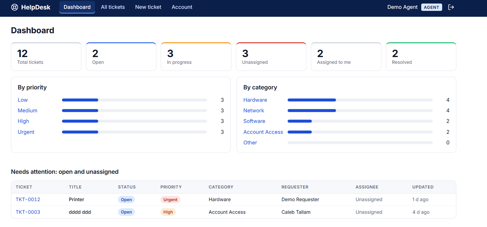
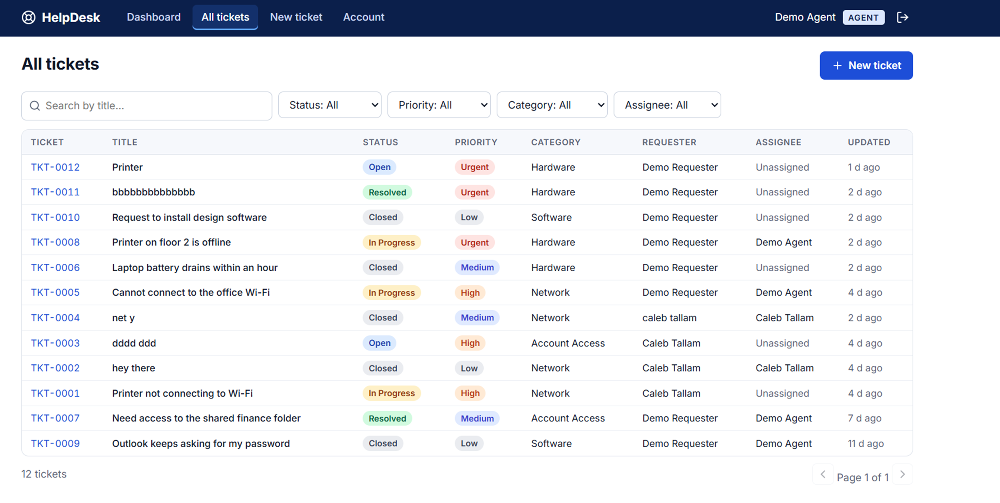
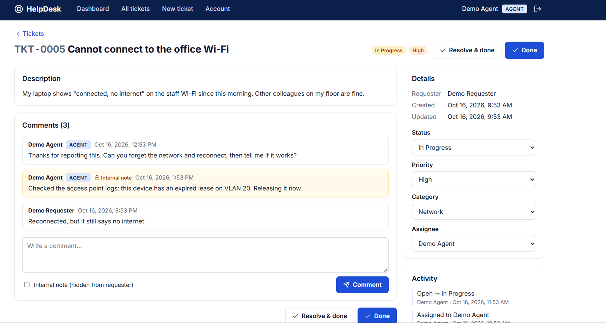

# IT Helpdesk & Ticketing System

A full-stack helpdesk where people sign up and raise IT support tickets, and support staff triage, assign and resolve them.

**Live demo:** https://helpdesk-system-phi.vercel.app
Use the *Try as a requester* or *Try as a support agent* buttons on the sign-in page. The API is hosted on a free plan, so the first request can take up to a minute to wake up.

## Features
- Sign up / sign in with JWT authentication and hashed passwords
- Three roles: **user** (own tickets only), **agent** and **admin** (all tickets)
- Create tickets with category and priority, filter and search them, auto-numbered `TKT-0001`
- Status workflow: Open → In Progress → Resolved → Closed
- Comments, including internal staff-only notes
- Activity history on every ticket
- Staff dashboard with counts by status, priority and category
- Email verification: sign-up needs a confirmation link (one-time, hashed token, 24 h expiry); disposable and non-existent email domains are rejected
- Change password, rate limiting, input validation

<!-- Add screenshots after taking them, then uncomment:



-->

## Tech stack
React, Vite, React Router · Node.js, Express · MongoDB Atlas, Mongoose · JWT, bcrypt, Zod, Helmet · Vercel + Render

## Run locally
```bash
# API
cd server && npm install && copy .env.example .env   # fill in .env
npm run dev                                          # http://localhost:5001

# App (second terminal)
cd client && npm install && copy .env.example .env
npm run dev                                          # http://localhost:5173
```

### Server environment variables
`MONGODB_URI`, `JWT_SECRET` (32+ chars), `CLIENT_URL` (allowed frontend origins, comma-separated), `PORT`.
Email (Brevo): `BREVO_API_KEY`, `EMAIL_FROM`, `EMAIL_FROM_NAME`, `APP_URL`. When these are set, new accounts must confirm their email address; without them sign-up works without confirmation.

### Useful commands (inside `server/`)
```bash
npm run set-role -- someone@example.com agent   # promote a user to agent or admin
npm run seed-demo                               # create or reset the demo accounts and sample tickets
```

## API overview
`/api/auth` (register, login, me, change-password) · `/api/tickets` (CRUD, stats, comments) · `/api/users` (agents, roles)
